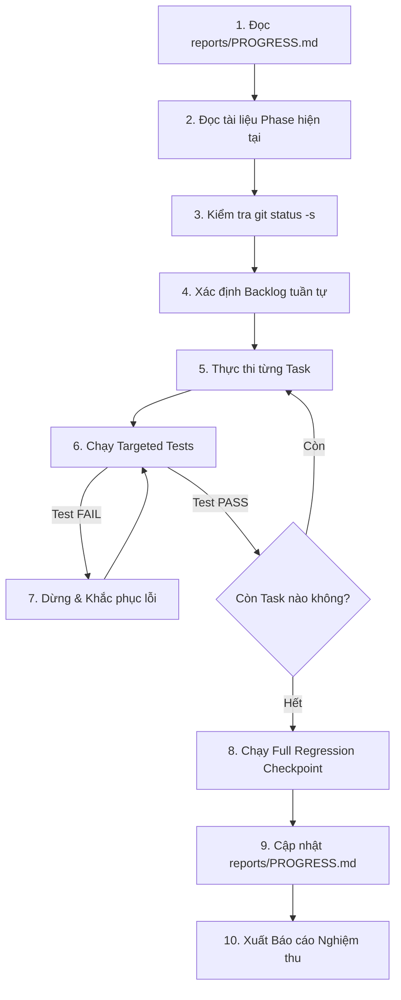

# WORKFLOW /execute-phase — TỰ ĐỘNG THỰC THI GIAI ĐOẠN

Quy trình tự động hóa thực thi từng Phase theo chuẩn kiến trúc và tối ưu hóa token.

## NGUYÊN TẮC VẬN HÀNH

- **Tự trị (Autonomous):** Không hỏi lại thông tin đã có trong tài liệu; không dừng lại chỉ để trình bày kế hoạch suông.
- **Tiết kiệm Token (Token-Efficient):** Đọc file có mục tiêu (line range), không dump source code ra chat, chỉ in summary/findings.
- **Bất biến (Invariant Baseline):** Không chạm vào Bát Trạch, Cung phi, Nạp Âm, Master Preset 89/51, Proposal Confirm Gate.

---

## CÁC BƯỚC THỰC THI CHUẨN

### Bước 1: Đọc `reports/PROGRESS.md`
- Đọc `reports/PROGRESS.md` để xác định:
  - `Current Phase` (ví dụ: `P8.3`).
  - `Pending Tasks` và `Active Findings`.
  - `Last Regression Results`.

### Bước 2: Đọc Đúng Báo Cáo Của Phase Hiện Tại
- Chỉ mở đúng thư mục tài liệu của Phase hiện tại (ví dụ: `reports/P8.2/` hoặc yêu cầu của `P8.3`).
- **Không** đọc quét lại toàn bộ repository hay các file đã nghiệm thu.

### Bước 3: Kiểm Tra Git Working Tree
- Chạy lệnh `git status -s` để nắm rõ các file đang sửa đổi hoặc chưa commit.

### Bước 4: Xác Định Backlog Cụ Thể
- Liệt kê danh sách các task cần thực hiện theo thứ tự ưu tiên (P0 $\to$ P1 $\to$ P2).

### Bước 5: Thực Hiện Tuần Tự Từng Task
- Sửa code có mục tiêu bằng công cụ `edit_file` / `write_file`.
- Tuân thủ nghiêm ngặt các nguyên tắc trong `AGENTS.md`.

### Bước 6: Chạy Test Liên Quan (Targeted Tests)
- Sau mỗi sửa đổi module, chỉ chạy file test trực tiếp liên quan đến module đó.
- *Ví dụ:* Sửa Three.js VRAM $\to$ chạy `p8_2_production_readiness.test.ts`.

### Bước 7: Xử Lý Khi Test Thất Bại
- Nếu test thất bại (FAIL): **DỪNG LẠI NGAY LẬP TỨC**.
- Phân tích nguyên nhân gốc, sửa code và chạy lại test cho đến khi PASS.
- Tuyệt đối không sửa expected test case để ngụy tạo kết quả PASS.

### Bước 8: Kiểm Thử Toàn Diện Tại Checkpoint (Full Regression)
- Khi hoàn thành tất cả task của Phase:
  - Chạy `npx tsc --noEmit` (bảo đảm 0 lỗi kiểu).
  - Chạy `npx tsx tests/run_all_tests.ts` (bảo đảm toàn bộ các suite PASS 100%).
  - Chạy `npm audit` (bảo đảm 0 lỗ hổng bảo mật).

### Bước 9: Cập Nhật `reports/PROGRESS.md`
- Cập nhật mục `Completed Sub-phases`, `Current Phase`, `Last Regression Results`, `Next Action`.

### Bước 10: Tạo Báo Cáo Nghiệm Thu Cuối Phase
- Tạo báo cáo nghiệm thu chuyên môn trong thư mục `reports/<PHASE>/` với bằng chứng đo lường thực tế.
- Báo cáo ngắn gọn cho người dùng: tóm tắt hoàn thành, findings đã xử lý và hành động tiếp theo.

