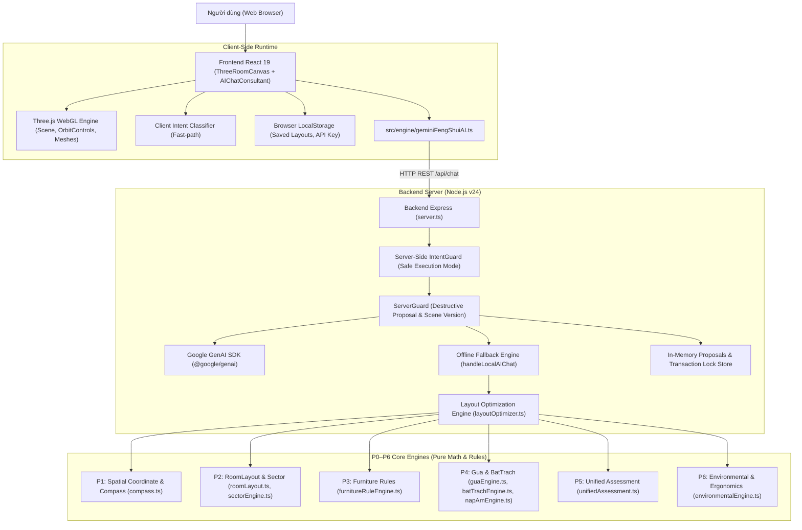
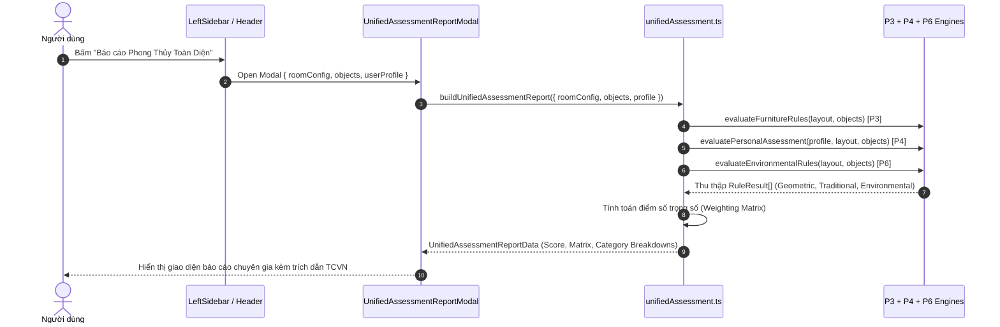
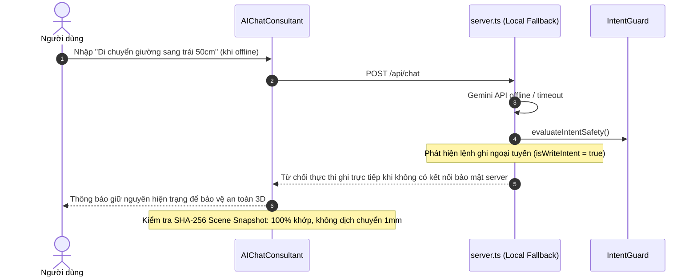

# P8.1 — KIẾN TRÚC THỰC TẾ & BẢN ĐỒ PHỤ THUỘC (ARCHITECTURE MAP)
## DỰ ÁN: AI FENG SHUI STUDIO (v1.0.0-p7.5)
**Ngày kiểm toán:** 12/11/2026  
**Đơn vị kiểm toán:** Senior Software Architect & AI Systems Auditor  
**Trạng thái hệ thống:** P0–P7.5 Frozen Architecture + PILOT-01.2 Verified  

---

## 1. TỔNG QUAN HỆ THỐNG (SYSTEM OVERVIEW)

AI Feng Shui Studio là hệ thống ứng dụng Web kết hợp giữa:
1. **Frontend SPA:** Xây dựng bằng React 19, TypeScript, Three.js (r186) và Tailwind CSS v4, chịu trách nhiệm mô phỏng không gian phòng ngủ 3D tương tác, tính toán góc nhìn, biểu diễn bóng mờ xem trước (Ghost Preview) và giao diện trò chuyện tư vấn phong thủy trực quan.
2. **Backend Server:** Node.js v24 + Express 4.21, chịu trách nhiệm tiếp nhận yêu cầu, phân loại và bảo vệ ý định an toàn (IntentGuard / ServerGuard), điều phối giao dịch (Transaction Manager), giao tiếp với Google Gemini 3.8 Flash, và cung cấp bộ máy dự phòng ngoại tuyến (Offline Fallback Engine).
3. **Core Feng Shui & Architectural Engine:** Tập hợp các module toán học thuần túy (Pure Functions) độc lập, không phụ thuộc UI, chịu trách nhiệm tính toán Bát Trạch Lữ Tài, Cung phi quái mệnh, Nạp Âm Lục Thập Hoa Giáp, hình học không gian OBB SAT, kiểm tra quy chuẩn kiến trúc (TCVN 4451:2012) và đánh giá hợp nhất (Unified Assessment).



---

## 2. PHÂN TẦNG VÀ RANH GIỚI MODULE (MODULE BOUNDARIES)

### 2.1. Tầng Trình diễn (Presentation Layer)
- **Vị trí thư mục:** `src/components/`, `src/App.tsx`, `index.html`
- **Các thành phần cốt lõi:**
  - `src/App.tsx`: Quản lý trạng thái gốc toàn cục (`roomConfig`, `objects`, `userProfile`, `evaluation`, `actionHistory`, `activeProposal`).
  - `src/components/ThreeRoomCanvas.tsx`: Khởi tạo `THREE.WebGLRenderer`, `THREE.Scene`, `THREE.PerspectiveCamera`, `OrbitControls`, ánh sáng thực nghiệm, lưới sàn, tường phòng, cửa đi/cửa sổ và các đối tượng nội thất 3D procedural. Quản lý hiển thị Ghost Preview khi có đề xuất bố trí.
  - `src/components/AIChatConsultant.tsx`: Khung chat tương tác AI, phân loại ý định nhanh ở client, kích hoạt popup nhập API Key, hiển thị thẻ đề xuất bố trí kèm 2 nút "Xem trước 3D" và "Áp dụng".
  - `src/components/LeftSidebar.tsx`: Điều khiển kích thước phòng (dài, rộng, cao, hướng), chọn quái mệnh gia chủ (năm sinh, giới tính) và chuyển đổi preset phòng ngủ mẫu.
  - `src/components/FurniturePalette.tsx`: Thanh công cụ thêm nhanh 14 danh mục nội thất.
  - `src/components/UnifiedAssessmentReportModal.tsx`: Hộp thoại hiển thị báo cáo phong thủy đa tầng hợp nhất (P5).
  - `src/components/SavedLayoutsModal.tsx`: Quản lý lưu và tải lại bố cục phòng từ `localStorage`.

### 2.2. Tầng Dịch vụ & Bảo vệ An toàn (Service & Guard Layer)
- **Vị trí thư mục:** `src/services/`, `server.ts`
- **Các thành phần cốt lõi:**
  - `src/services/intentGuard.ts`: Bộ lọc phân loại ý định an toàn độc lập, xác định một trong 6 chế độ thực thi:
    - `THEORY`: Tư vấn lý thuyết, cấm hoàn toàn mọi thay đổi 3D.
    - `ANALYZE`: Phân tích đọc dữ liệu hiện trạng.
    - `PROPOSE`: Đề xuất phương án bố trí (phát sinh thẻ đề xuất và Ghost Preview, không ghi đè scene gốc).
    - `COMMAND`: Lệnh thực thi trực tiếp có mục tiêu cụ thể.
    - `UNDO`: Hoàn tác lịch sử.
    - `CHAT`: Trò chuyện tổng quát ngoài phạm vi.
  - `src/services/serverGuard.ts`: Chốt chặn bảo mật phía máy chủ đối với các lệnh gọi hàm của Gemini (Function Calling):
    - Đánh giá lại raw user message, không tin tưởng client-sent labels.
    - Quản lý vòng đời Thẻ Đề Xuất (Proposal): `createDestructiveProposal`, `confirmProposal`.
    - Tính toán băm toàn vẹn không gian (`computeSceneVersion`).
    - Lưu trữ danh sách khóa giao dịch đang chờ (`pendingConfirmations`).

### 2.3. Tầng Bộ máy Phong thủy & Kiến trúc (Core Feng Shui & Rule Engine Layer)
- **Vị trí thư mục:** `src/engine/core/`
- **Nguyên tắc thiết kế:** 100% Pure Functions, Zero Side-Effects, Không phụ thuộc Three.js hay DOM.
- **Phân định trách nhiệm từng module:**
  - `compass.ts`: Hệ tọa độ không gian 2D/3D, chuẩn hóa góc quay Yaw Three.js V2, chuyển đổi phương vị 8 hướng và 24 sơn hướng.
  - `roomLayout.ts`: Cấu trúc dữ liệu hình học phòng (`polygon`, `walls`, `openings`, `beams`), bộ chuyển đổi legacy adapter (`buildLayoutFromLegacy`).
  - `sectorEngine.ts`: Tính toán giao cắt OBB SAT, kiểm tra vị trí điểm trong đa giác sàn, phân cung 8 hướng Bát Trạch.
  - `guaEngine.ts`: Tính toán Cung Phi Bát Trạch theo năm sinh âm lịch và giới tính (công thức Lữ Tài).
  - `lapXuanCalendar.ts`: Giải quyết điểm biên chuyển giao năm Bát Trạch qua tiết Lập Xuân.
  - `napAmEngine.ts`: Tính toán Nạp Âm Lục Thập Hoa Giáp và tương sinh/tương khắc ngũ hành.
  - `batTrachEngine.ts`: Tra cứu 4 Cát tinh (Sinh Khí, Thiên Y, Diên Niên, Phục Vị) và 4 Hung tinh (Tuyệt Mệnh, Ngũ Quỷ, Lục Sát, Họa Hại).
  - `furnitureRuleEngine.ts` (P3): 9 quy tắc bố trí nội thất Loan Đầu và Hình Thế (`BED-WALL-01`, `BED-DOOR-01`, `BED-WIN-01`, `BED-WC-01`, `DESK-ORI-01`, `DESK-WALL-01`, `DESK-DOOR-01`, `MIRROR-BED-01`, `MIRROR-ORI-01`).
  - `personalAssessment.ts` (P4): Đánh giá tương thích bản mệnh gia chủ với hướng đầu giường, bàn làm việc và hướng phòng.
  - `unifiedAssessment.ts` (P5): Bộ máy tổng hợp điểm số phong thủy đa tầng hợp nhất.
  - `environmentalEngine.ts` (P6): 17 quy tắc vi khí hậu, thông gió tự nhiên, chiếu sáng tự nhiên và công thái học thông thủy theo TCVN 4451:2012.
  - `sourceRegistry.ts`: Đăng ký nguồn trích dẫn học thuật và tiêu chuẩn xây dựng quốc gia.

### 2.4. Tầng Agent & Giao dịch Độc lập (Agent & Transaction Layer)
- **Vị trí thư mục:** `src/engine/agent/`
- **Module:**
  - `proposalManager.ts`: Quản lý lưu trữ đề xuất bộ nhớ đệm, thời gian sống TTL (300.000ms), cơ chế atomic consume chống race-condition.
  - `transactionManager.ts`: Quản lý vòng đời giao dịch: BEGIN $\to$ EXECUTE $\to$ VALIDATE $\to$ COMMIT / ROLLBACK.
  - `sceneHasher.ts`: Sinh SHA-256 canonical hash cho toàn bộ trạng thái không gian (tường, cửa, kích thước, vật thể, góc quay).
  - `unifiedAgent.ts`: Bộ điều phối Unified Agent tích hợp (được kiểm thử độc lập trong Suite 10, chưa nối trực tiếp vào `server.ts`).

---

## 3. BIỂU ĐỒ LUỒNG DỮ LIỆU ĐẦU-CUỐI (END-TO-END DATA FLOWS)

### 3.1. Luồng 1: Yêu cầu Đề xuất Bố trí Nội thất (Proposal -> Ghost Preview -> Confirm -> Mutate)

```mermaid
sequenceDiagram
    autonumber
    actor User as Người dùng
    participant UI as AIChatConsultant (Client)
    participant Srv as server.ts (Express)
    participant Guard as IntentGuard & ServerGuard
    participant Opt as layoutOptimizer.ts
    participant Canvas as ThreeRoomCanvas (Three.js)

    User->>UI: Nhập "Đề xuất bố trí phòng ngủ phù hợp mệnh"
    UI->>Srv: POST /api/chat { message, roomConfig, objects, userProfile }
    Srv->>Guard: evaluateIntentSafety() -> mode: 'PROPOSE'
    Note over Guard: Không cho phép tự ý ghi Scene (Safe to Execute = false)
    Srv->>Opt: generateOptimizedLayout(userProfile, roomConfig, objects)
    Opt-->>Srv: Trả về proposal (beforeScore: 51, afterScore: 72, adjustments[])
    Srv-->>UI: Response { success: true, optimizationProposal, aiActions }
    Note over UI: Scene 3D thực tế GIỮ NGUYÊN 100%
    UI->>User: Hiển thị Thẻ Đề Xuất kèm 2 nút: "Xem trước 3D" & "Áp dụng"
    
    User->>UI: Bấm "Xem trước 3D" (Ghost Preview)
    UI->>Canvas: onPreviewProposal(adjustments)
    Canvas->>Canvas: Tạo mesh bóng mờ bán trong suốt (opacity: 0.45)
    Note over Canvas: Tọa độ đồ vật thực tế KHÔNG THAY ĐỔI
    
    User->>UI: Bấm "Áp dụng" (Confirm Gate)
    UI->>Srv: POST /api/chat/confirm { proposalId, sceneVersion }
    Srv->>Guard: confirmProposal(proposalId, sceneVersion)
    Guard-->>Srv: Atomic claim SUCCESS (proposal consumed)
    Srv-->>UI: Response { success: true, proposalId }
    UI->>Canvas: onApplyMultipleAdjustments(adjustments)
    Canvas->>Canvas: Cập nhật tọa độ thực tế của Scene & xóa Ghost Preview
    Canvas-->>User: Hiển thị kết quả bố trí mới thành công
```

### 3.2. Luồng 2: Báo cáo Đánh giá Phong thủy Hợp nhất (Unified Assessment Flow)



### 3.3. Luồng 3: Từ chối Ghi Ngoại tuyến & Bảo vệ Bất biến Không gian (Offline Safety Refusal)



---

## 4. CÁC ĐIỂM BẤT CẬP KIẾN TRÚC ĐƯỢC PHÁT HIỆN (ARCHITECTURAL GAPS)

Qua đối soát source code thực tế so với thiết kế, phát hiện các điểm sai lệch cấu trúc sau:

1. **Sự phân tách giữa `src/engine/agent/unifiedAgent.ts` và `server.ts`:**
   - `unifiedAgent.ts` (và `transactionManager.ts`, `proposalManager.ts`) được xây dựng trong Phase P7 và kiểm thử rất kỹ trong `p7_agent_execution.test.ts`.
   - Tuy nhiên, `server.ts` hiện tại lại sử dụng một implementation riêng (dòng 970–1624) gọi trực tiếp `@google/genai` và sử dụng `src/services/serverGuard.ts` để lưu `pendingConfirmations` trên một Map cục bộ.
   - *Đánh giá:* Hệ thống tồn tại **2 đường ống xử lý AI song song** (Duplicate Pipeline Architecture). `server.ts` chưa liên kết trực tiếp vào `UnifiedGeminiAgent` class của P7.

2. **Cơ chế lưu trữ Bố cục cục bộ (Client-Side Storage vs Server Persistence):**
   - Bố cục phòng lưu trữ hoàn toàn tại `localStorage` trình duyệt (`layoutStorage.ts`).
   - Máy chủ không sở hữu database để lưu vết người dùng, lịch sử phiên hoặc snapshot lịch sử giữa các thiết bị.

---

## 5. KẾT LUẬN KIẾN TRÚC

Kiến trúc hiện tại đảm bảo **nguyên tắc an toàn tối thượng**:
- Toàn bộ các thao tác ghi đều bị chặn nếu không qua bước xác nhận (Confirm Gate).
- Các bộ máy tính toán Bát Trạch và Môi trường P0–P6 hoạt động độc lập, không có phụ thuộc vòng và không làm biến đổi trạng thái giao diện.
- Ranh giới giữa mã toán học (Pure Engine) và mã tương tác (Three.js Canvas / Express) được phân định rõ ràng.

